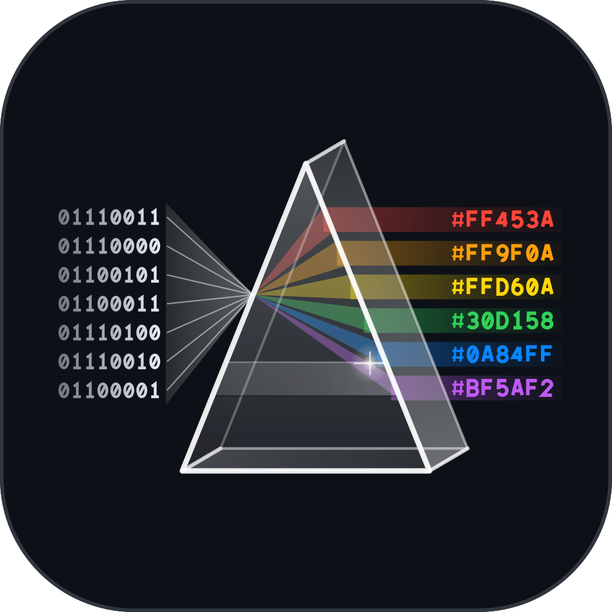
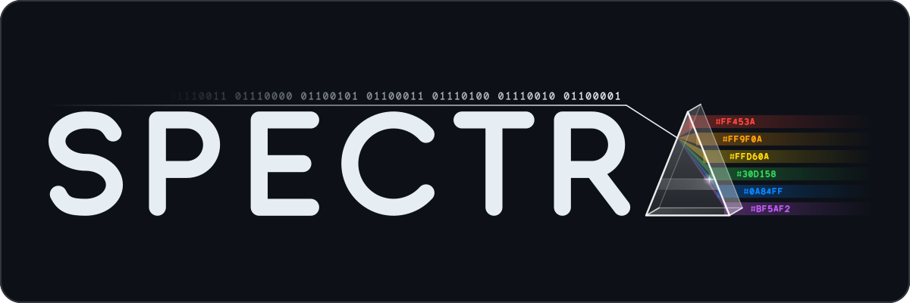

# Brand





## The mark

A glass prism shaped like the wordmark's A takes in white light, which is the ASCII bits of
"spectra" (`01110011 01110000 01100101 01100011 01110100 01110010 01100001`). It splits that
light into the spectrum, labelled with each colour's hex code. Where the letter's crossbar would
be, the prism has a frosted (sandblasted) band, with a glint where the band meets the right
edge. The full artwork ("Compressed Ledger") puts the seven bytes in a column on the left that
converges into the prism, and the six hex labels in a column on the right. The wordmark sets
SPECTR in round stroked capitals and uses the prism as the A. The bits ride a beam over the
letters into the prism.

All of it is described once, in Rust, in [`src/mark/`](../src/mark/):

- `art.rs`: the prism (`PRISM`: apex, baseline, depth, crossbar band), the full layout
  (`LEDGER`), the simplified one for small sizes (`BARS`), the 32 and 16 px favicons, the menu
  bar template, the wordmark's letter paths and every framing.
- `glyphs.rs`: a small bold monospace drawn as stroke skeletons, for `0-9 A-F # x`. SVG
  `<text>` would render in whatever font the viewer has, and the rasterizer can't draw fonts,
  so every label is a path. That way SVGs and PNGs look the same everywhere. Metrics follow
  Menlo, which the approved masters were drawn in.
- `scene.rs`: paths, fills, strokes, gradients, clips and blur as data, written out as SVG.
- `raster.rs`: a std-only supersampling rasterizer for the same scenes. It flattens arcs and
  curves and strokes them into polygons with round or mitred joins and caps.
- `png.rs`: a std-only PNG writer (adaptive filters, DEFLATE with dynamic Huffman codes).
- `assets.rs`: every file in `assets/brand/`, plus the `.icns` and `.ico` writers.

The wordmark is drawn both as SVG (the letter strokes keep the approved path data: cubic and
arc commands with round caps and joins) and as a PNG. For the PNG, the rasterizer flattens
those arcs and curves.

## Colours

| Role | Hex |
| --- | --- |
| Ground | `#0d1117` |
| Rim | `#30363d` |
| Ink (letters, beam, bright bits) | `#e6edf3` |
| Dim bits | `#6e7681` |
| Prism edges at small sizes | `#f0f6fc` |
| Spectrum, top to bottom | `#FF453A` `#FF9F0A` `#FFD60A` `#30D158` `#0A84FF` `#BF5AF2` |

The glass is white at 3–38% opacity over whatever is behind it, and the frosted band is white
at 10–26%.

## Files

Everything is under [`assets/brand/`](../assets/brand/).

| File | Size | What it is |
| --- | --- | --- |
| `spectra-icon.svg` | 1024 | The app tile: full artwork on a radius-224 dark tile with a rim. Logo mark and web app icon. |
| `spectra-icon-dock.svg` | 1024 | The same art on Apple's icon grid: an 824-point superellipse (n = 5) with a soft shadow. |
| `spectra-icon-small.svg`, `spectra-icon-small-dock.svg` | 1024 | The small-size artwork, with text turned into bars, on the tile and on the Dock body. |
| `spectra-icon-maskable.svg` | 1024 | Full-bleed square ground, with the art inside the 80% safe circle. |
| `spectra-favicon-32.svg`, `spectra-favicon-16.svg` | 32, 16 | The favicon simplifications. The 16 is hand-set pixels. |
| `spectra-wordmark.svg` | 1200×400 | The wordmark on its dark plate. |
| `spectra-wordmark-bare.svg` | 1200×400 | The wordmark with no plate, for dark pages. |
| `png/spectra-icon-{16,32,48,64,128,256,512,1024}.png` | 16–1024 | The app icon: full art from 180 px, bars at 48–128, the favicons at 32 and 16. |
| `macos/spectra.icns` | 16–1024 | The Dock icon, all ten slots. Full art at 256 px and up, bars at 32–128, the 16 px pixels at 16@1x. 16 and 32 px are `ic04`/`ic05` ARGB, the rest PNG. |
| `macos/spectraTemplate.svg`, `spectraTemplate.png`, `spectraTemplate@2x.png` | 18, 36 | Menu bar template: black and alpha only, on a 36 grid (18 pt @2x). The three rays are their own group (`spectra-tray-rays`) for status states. |
| `favicon.ico` | 16, 32, 48 | The 16 px pixels, the 32 px favicon and the bars at 48. |
| `web/favicon-16.png`, `web/favicon-32.png` | 16, 32 | The favicons as PNG. |
| `web/apple-touch-icon.png` | 180 | Full art on a square ground (iOS rounds the corners itself). |
| `web/icon-192.png`, `web/icon-512.png` | 192, 512 | Web manifest `purpose: any`. |
| `web/icon-maskable-192.png`, `web/icon-maskable-512.png` | 192, 512 | Web manifest `purpose: maskable`. |
| `web/spectra-wordmark.png` | 1200×400 | The wordmark on its plate. |
| `web/social-preview.png` | 1280×640 | The wordmark centred on the ground (GitHub's social preview size). |
| `linux/hicolor/{16,24,32,48,64,128,256,512}x…/apps/io.github.kaeawc.SpectraDesktop.png`, `linux/hicolor/scalable/apps/io.github.kaeawc.SpectraDesktop.svg` | 16–512 | The Linux icon theme set, named after the app id in [`packaging/linux/`](../packaging/linux/). |

`scripts/desktop-app.sh` bundles the window as `target/release/Spectra.app`, with
`CFBundleIconFile` set to the `.icns`.

## Regenerating

```sh
scripts/brand.sh          # redraws assets/brand/ (cargo run --release --example brand)
scripts/brand.sh /tmp/x   # somewhere else, to compare
```

Edit `src/mark/art.rs` (or the glyphs), run the script and commit what changed.
`committed_svgs_match_the_code` fails while the committed SVGs differ from what the code draws.
The rasters are only checked for presence and size, because drawing them all takes a while in a
debug build.

## Weak sizes

- **16 px**: the hand-set pixels read as a prism between bits and a rainbow, but the crossbar
  is a single light row and barely reads. In the `.icns`, the 16@1x slot is a full-bleed tile,
  while the 16@2x and 32 slots use the Dock body with its margins. In a Finder list, the 16 is
  larger than its neighbours.
- **32 px in the Dock** (`.icns` 32@1x and 16@2x): the bars artwork on the Dock body is
  recognisable but muddy. The bit rows are grey smudges. The favicon's 32 px drawing is
  sharper, but it is full-bleed.
- **48 px** (`favicon.ico`, `png/spectra-icon-48.png`): the bit rows of the bars artwork merge
  into a grey hatched block. The prism and the rainbow stay clear.
- **128 px and down**: the full artwork's text turns to texture, which is why those sizes use
  the bars.
- **180–192 px** (`apple-touch-icon`, `icon-192`): the full artwork is used, as the approved set
  specifies. The hex labels are about 7 px tall there: legible up close, texture at a glance.
- **Glyphs**: the built-in monospace is close to Menlo Bold, not identical. The `#` is drawn
  lighter than the figures, or its strokes close into a blot. The `0` is slashed and the `A` is
  flat-topped.
