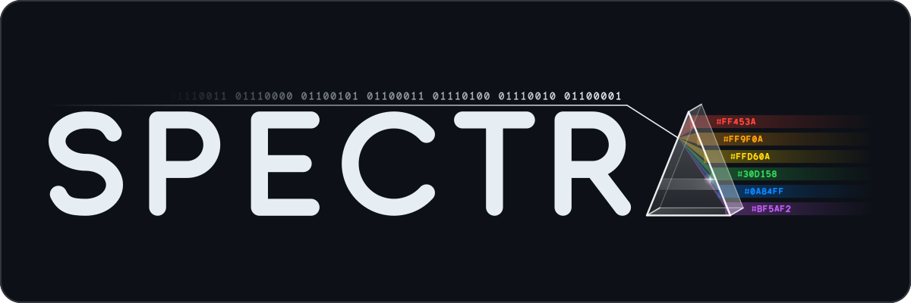
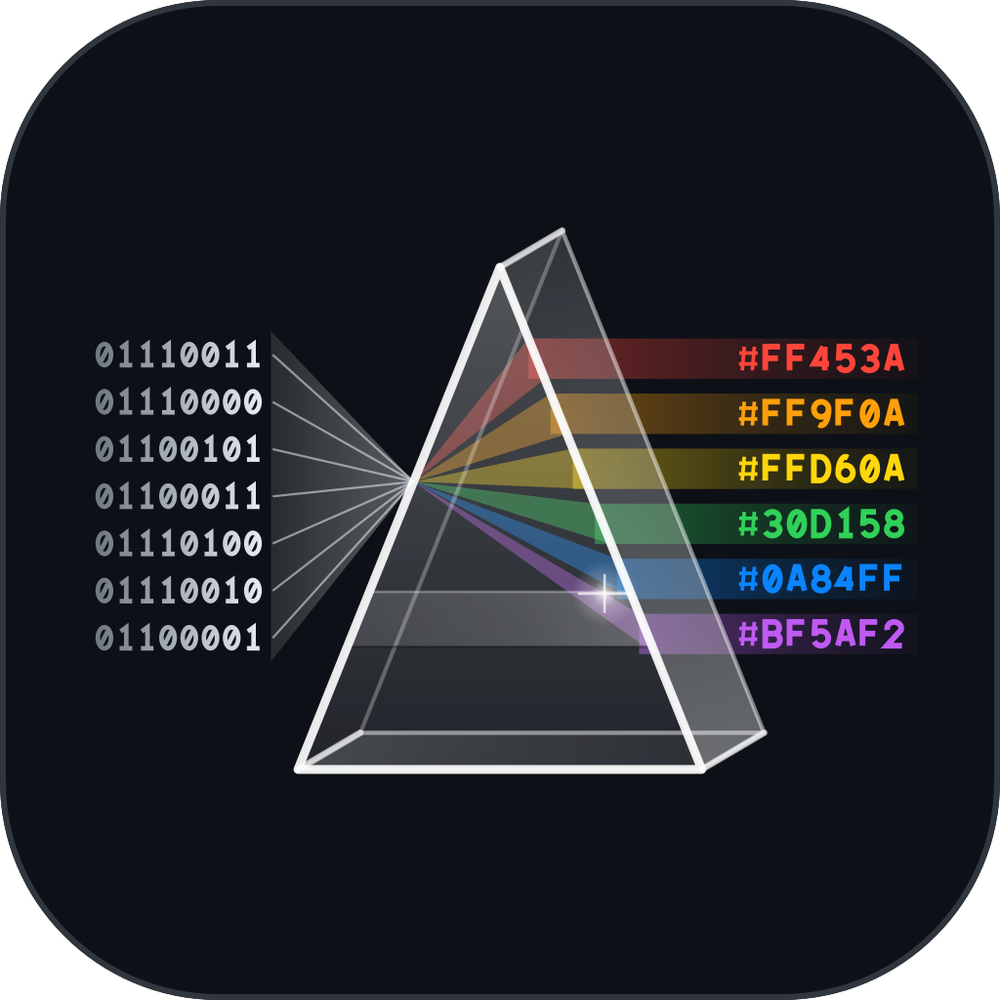

# Brand

Spectra's mark is a glass prism cut to the shape of the wordmark's A. White light made of the
ASCII bits of "spectra" (`01110011 01110000 01100101 01100011 01110100 01110010 01100001`)
goes in, and the spectrum comes out, each band labelled with its own hex colour. The prism's
crossbar is a frosted, sandblasted band. Raw bits in, a readable diagnosis out.

## Where it is defined

The mark is described once, in Rust, in
[spectra-desktop](https://github.com/kaeawc/spectra-desktop)'s `src/mark/`. That code writes
every icon, favicon, menu bar template, `.icns`, Linux icon and the wordmark into its
`assets/brand/`; run `scripts/brand.sh` there after changing it. Labels are drawn as paths,
not `<text>`, so the SVGs look the same in every browser.

The files in `docs/assets/brand/` are copies of that output. Copy them again when the mark
changes.

## Files in this repo

| File | Use |
| --- | --- |
| `spectra-wordmark.svg` | README header and docs, on its own dark plate |
| `spectra-wordmark-bare.svg` | The wordmark on a transparent ground, for dark pages |
| `spectra-icon.svg` | The full mark: GitHub avatar, docs, large icons |
| `spectra-icon-small.svg` | The mark simplified for 48–128 px (bits and hex as bars); the docs site logo |
| `favicon.ico`, `favicon-32.png`, `favicon-16.png` | Favicons; the 16 px version is hand-set pixels |
| `apple-touch-icon.png` | 180 px home-screen icon |
| `social-preview.png` | 1280×640 GitHub social preview, uploaded in the repository's settings |

The macOS `.icns`, menu bar template and Linux hicolor icons live in spectra-desktop, which
ships the app.

## Colours

| Role | Hex |
| --- | --- |
| Ground | `#0d1117` |
| Rim | `#30363d` |
| Letters | `#e6edf3` |
| Red band | `#FF453A` |
| Orange band | `#FF9F0A` |
| Yellow band | `#FFD60A` |
| Green band | `#30D158` |
| Blue band | `#0A84FF` |
| Purple band | `#BF5AF2` |

## Small sizes

The full mark's bits and hex labels are only legible at 256 px and up. Below that the icons
switch to the simplified artwork, where the bytes become dashed rows (the bright dashes are
the real 1 bits) and the hex labels become solid colour blocks. At 48 px the bit rows merge,
and at 16 px the frosted crossbar only just reads.
